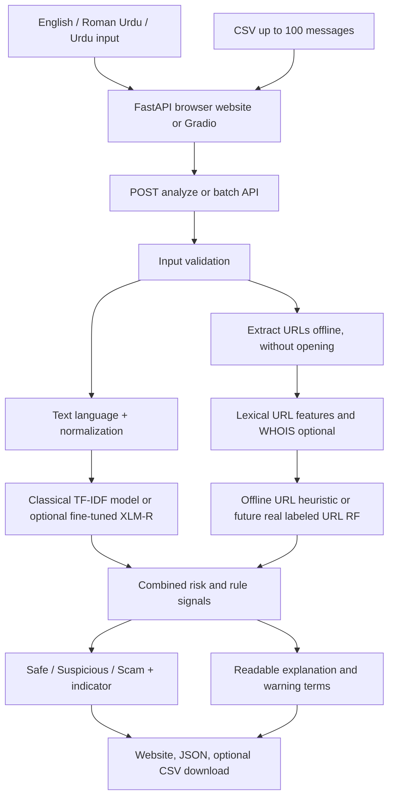
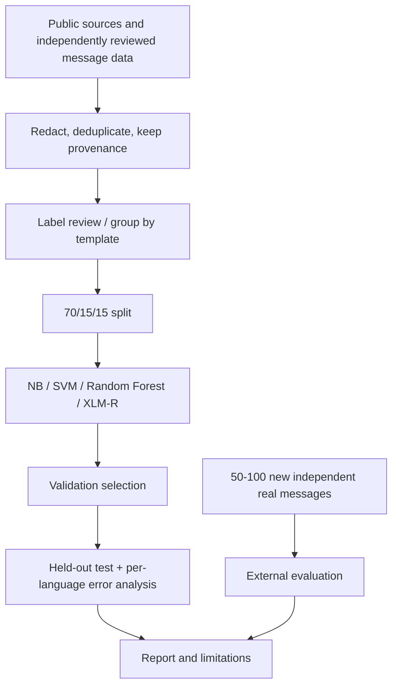

# PhishGuard-PK v2 architecture

## Evaluation architecture

No suspicious user URL is visited or executed during analysis. Optional WHOIS looks up domain registration metadata and is OFF by default.
